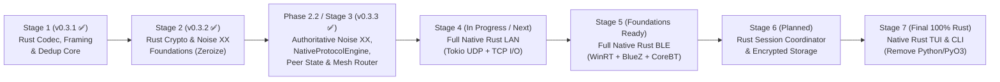

# BitChat Architecture & Rust Migration Roadmap

This document defines the canonical 7-stage engineering roadmap for **BitChat RustPy**, tracking its progression from a pure-Python application (`v0.1.0`–`v0.2.1`) through the current hybrid Python + authoritative Rust protocol architecture (`v0.3.3`) toward a standalone native Rust application.

> **Engineering Policy:** This roadmap tracks architectural milestones and testable acceptance criteria without promising calendar release dates. We strictly distinguish between **(a) Completed & Production-Authoritative**, **(b) Native Foundations Integrated with Python I/O**, and **(c) Planned Future Work**. BitChat `v0.3.3` is a hybrid Python + Rust application (~50–55% Rust architectural ownership across protocol-critical paths) and is **not** yet a 100% native Rust binary.

---

## 1. Strategic Architectural Direction

| Stage / Milestone | Architectural Ownership | Status | Release |
| :--- | :--- | :--- | :--- |
| **Legacy Baseline** | 100% Python (`asyncio` + `Textual` + pure-Python protocol/mesh) | Superseded | `v0.1.0`–`v0.2.1` |
| **Stage 1 — Protocol & Mesh Hot-Path Core** | Hybrid Python + Rust `bitchat._bitchat_core` (binary codec, padding, fragmentation, reassembly, TCP framing, dedup, rate limiting, TUI overhaul, uninstaller) | ✅ **Completed** | `v0.3.1` |
| **Stage 2 / Phase 2 — Native Rust Cryptography & Foundations** | Native Rust `X25519`, `Ed25519`, `ChaCha20-Poly1305`, `AES-256-GCM`, `HKDF`, `PBKDF2`, `Zeroize`, Noise XX engine, 12-phase FSM, LAN/BLE helper foundations | ✅ **Completed** | `v0.3.2` |
| **Phase 2.2 / Stage 3 — Authoritative Rust Protocol & Peer State Engine** | Authoritative `NativeNoiseSession`, single-FFI `NativeProtocolEngine`, `NativePeerStateEngine`, authoritative `NativeMeshRouter` / `NativeStoreAndForwardQueue` / `NativeAckTracker`, collision-safe `bitchat-tui` interop, bounded queues, runtime LAN IP limiter & BLE ATT MTU sizing | ✅ **Completed** | `v0.3.3` |
| **Stage 4 — Fully Native Rust LAN Transport** | Move full UDP discovery and TCP server/client socket lifecycle & async I/O loops into Rust (Tokio) | 🔄 **Foundations Wired; Full Async I/O Planned** | Future (`v0.4.x`) |
| **Stage 5 — Fully Native Rust BLE Transport** | Move full OS BLE Central & Peripheral drivers (WinRT, BlueZ D-Bus, CoreBluetooth) into Rust | 🔄 **State/MTU Foundations Wired; OS Drivers Planned** | Future (`v0.4.x`–`v0.5.x`) |
| **Stage 6 — Native Rust Session Coordinator & Secure Local Storage** | Move coordinator lifecycle, `~/.bitchat/` storage (`identity.json`, `config.json`, optional passphrase encryption), logging, and uninstaller into Rust | 📋 **Planned** | Future (`v0.6.x`) |
| **Stage 7 — Native Rust TUI & CLI (Retire Python/PyO3)** | Replace Python Textual UI & CLI with native Rust UI (`ratatui`) and CLI; remove Python, PyO3, and Maturin | 📋 **Planned (Final Objective)** | Future (`v1.0.0`) |

---

## 2. Historical Note: Why Rust Replaced the Early Nim Prototype

During early `v0.2.x` exploration, a minimal C-ABI prototype was tested in `nim/` (`nim/protocol/packet_codec.nim`) to evaluate FFI overhead for binary header parsing. Profiling demonstrated that moving **stateful, allocation-heavy protocol subsystems** into a zero-copy **Rust + PyO3 (`abi3-py312`) + Maturin** crate (`rust/bitchat-core`) eliminated Python object churn and enabled cohesive single-crossing execution (`NativeProtocolEngine`).

The legacy `nim/` directory is retained strictly as an archived historical reference and is never compiled, packaged, or loaded at runtime.

---

## 3. The 7-Stage Python-to-Rust Migration Roadmap

---

### Stage 1 — Rust Protocol & Mesh Hot-Path Core, TUI Responsiveness & Uninstaller (`v0.3.1` — ✅ Completed)

Implemented in `rust/bitchat-core` (`bitchat._bitchat_core`) and integrated via `src/bitchat/_native.py`:

- **Build & Packaging Foundation:** Cargo workspace (`Cargo.toml`, `rust/bitchat-core/Cargo.toml`) compiled via `maturin` (`pyproject.toml`) into `bitchat._bitchat_core` (`abi3-py312`).
- **Native Binary Wire Codec:** `encode_packet_raw`, `decode_packet_raw`, `pad_packet_data`, `unpad_packet_data`, `get_optimal_block_size`, `peer_id_to_hex`, and `peer_id_from_hex` (`FIXED_HEADER_SIZE = 14`, `MINIMUM_PACKET_SIZE = 22`, block sizes `256`/`512`/`1024`/`2048` B).
- **Native Fragmentation, Stream Framing & Bounded Reassembly:** `fragment_encoded_packet_raw`, `NativeFragmentReassembler` (`MAX_FRAGMENTS_PER_ASSEMBLY = 1000`, `MAX_ACTIVE_ASSEMBLIES = 100`, `MAX_REASSEMBLED_BYTES = 150_000`), and `NativeStreamFramer` (`BC\x01\x00` + 4-byte length prefix).
- **Native Mesh Deduplication & Rate Limiting:** `compute_packet_id_raw`, `NativePacketDeduplicator` (SHA-256 `[:16]` LRU/TTL cache), and `NativePeerRateLimiter`.
- **TUI Responsiveness & Cross-Platform Uninstaller:** In-place sidebar diffing, coalesced chat rendering, and `bitchat --uninstall`.

---

### Stage 2 / Phase 2 — Native Rust Cryptography & Noise XX Foundations (`v0.3.2` — ✅ Completed)

- Implemented `X25519` (low-order point rejection), `Ed25519`, `ChaCha20-Poly1305`, `AES-256-GCM`, `HKDF-SHA256`, and `PBKDF2-HMAC-SHA256` in `rust/bitchat-core/src/crypto.rs` with `zeroize::ZeroizeOnDrop`.
- Implemented `Noise_XX_25519_ChaChaPoly_SHA256` (`NativeNoiseHandshakeState`, `NativeNoiseSymmetricState`, `NativeNoiseCipherState`, `NativeNoiseSession`) and the 12-phase `NativeHandshakeStateMachine` in `rust/bitchat-core/src/noise.rs`.
- Implemented native LAN helper foundations (`lan.rs`: interface scoring, subnet broadcast targeting, connection arbitration, discovery codec, IP rate limiter) and BLE helper foundations (`ble.rs`: connection state engine, notification buffering, MTU write chunk calculator, manufacturer payload codec).

---

### Phase 2.2 / Stage 3 — Authoritative Rust Protocol Integration, Noise XX Interop & Mesh/Peer State Engine (`v0.3.3` — ✅ Completed)

Completed and verified across `rust/bitchat-core/src/` (`engine.rs`, `noise.rs`, `protocol.rs`, `mesh.rs`, `lan.rs`, `fragmentation.rs`) and `src/bitchat/`:

- **Authoritative `NativeNoiseSession`:** `NoiseSession` delegates handshake, encryption/decryption, replay protection (including nonce `0`), fail-closed `u32::MAX` nonce exhaustion guard, and reconnect `reset_for_rehandshake()` zeroization directly to Rust with zero eager Python key copies.
- **Cohesive Single-FFI `NativeProtocolEngine`:** Consolidates decode → fragment reassembly → mesh routing/dedup/rate-limiting → dispatch (`0x01`/`0x04`/`0x0A`/`0x10`/`0x11`/`0x12`/`0x13`/`0x25`) → Noise advancement → outbound encode into **1 PyO3 crossing** (measured `7.28x–8.04x` faster inbound DM pipeline and `105.7 KiB → 0.8 KiB` Python `tracemalloc` peak allocation).
- **Authoritative `NativePeerStateEngine`:** Bounded peer tables, collision-safe `peer_id <-> fingerprint` registry with reverse collision index, anti-spoofing nickname protection, bounded pending DM queues (`32` per peer / `512` global), and distinct `observed` / `authenticated` / `verified` trust levels.
- **Single-Pass Authoritative Mesh & Store-and-Forward:** Removed dual Python+Rust execution in `MeshRouter` and `StoreAndForwardQueue`; wired `NativeAckTracker` (`0x0A`) and `0x13 NoiseIdentityAnnounce`.
- **Controlled `bitchat-tui` Interoperability:** Supported legacy 4-byte zero-extended peer IDs (`XXXXXXXX00000000`) bound strictly post-Noise-authentication with impostor collision rejection while preserving strict SHA-256 verification for modern peers.
- **Runtime Transport Wiring:** Wired `NativeIpRateLimiter` into `LANDiscovery`, wired controller ATT MTU (`client.mtu_size`) into `NativeBleConnectionEngine` + `compute_ble_write_chunk_size`, and replaced `asyncio.sleep(0.04)` polling in `SessionCoordinator` with event-driven `asyncio.Event`.

---

### Stage 4 — Fully Native Rust LAN Transport (🔄 Foundations Wired; Full Async I/O Planned)

- **Already Implemented & Integrated (`v0.3.2`–`v0.3.3`):** `NativeStreamFramer`, `select_best_lan_ip`, `compute_subnet_broadcast`, `compute_broadcast_targets`, `arbitrate_simultaneous_connection`, `encode_discovery_packet_raw` / `decode_discovery_packet_raw`, `NativeIpRateLimiter` (wired in `LANDiscovery`), and Tokio framing helper prototypes in `rust/bitchat-core/src/lan.rs`.
- **Remaining Work to Complete Stage 4:**
  - Move the active UDP discovery socket loop (bind, multi-subnet directed broadcast scheduling, peer TTL expiry) from `src/bitchat/network/discovery.py` into a native Tokio runtime task.
  - Move the active TCP server listener, outbound connection manager, `MAX_CONCURRENT_CONNECTIONS = 32` enforcement, and framed read/write loops from `src/bitchat/network/tcp_transport.py` into Rust, feeding frames directly into `NativeProtocolEngine` without crossing Python per frame.
- **Testable Acceptance Criteria:**
  - Two-node encrypted DM and multi-hop relay over live loopback TCP + UDP discovery executing entirely inside Tokio with Python handling only UI events.
  - Connection limit (`32`), max frame size (`65,536` B), and per-IP UDP rate limit (`10` pkts/s) enforced solely in Rust under concurrent stress tests on Windows and Linux.
  - Zero regression in `tests/network/` and `tests/e2e/` integration suites.

---

### Stage 5 — Fully Native Rust BLE Transport (🔄 State/MTU Foundations Wired; OS Drivers Planned)

- **Already Implemented & Integrated (`v0.3.2`–`v0.3.3`):** `NativeBleConnectionEngine` (notification buffering during `SUBSCRIBING`, readiness gating), `compute_ble_write_chunk_size` (wired to controller `client.mtu_size`), and `encode_ble_manufacturer_payload` / `decode_ble_manufacturer_payload` in `rust/bitchat-core/src/ble.rs`.
- **Remaining Work to Complete Stage 5:**
  - Replace Python `bleak` / `winrt` / `dbus-fast` transport loops with native Rust OS BLE backends:
    - **Linux:** Native BlueZ D-Bus GATT Central & Peripheral (`zbus` / `bluer`).
    - **Windows:** Native WinRT Bluetooth LE GATT Central & Peripheral (`windows-rs`), preserving graceful fallback when WinRT GATT advertising returns status 3.
    - **macOS:** Evaluate and implement CoreBluetooth Central & Peripheral bindings (`objc2` / `btleplug`) where OS permissions permit.
- **Testable Acceptance Criteria:**
  - Simulated adapter parity tests and physical two-machine BLE Central ↔ Peripheral Noise XX DM verification across Windows and Linux (and macOS where supported).
  - ATT MTU negotiation, 20 ms fragment pacing, GATT subscription notification buffering, and adapter retry/fallback verified natively in Rust.

---

### Stage 6 — Native Rust Session Coordinator, Secure Local Storage & Uninstaller (📋 Planned)

- **Remaining Work:**
  - Migrate remaining lifecycle orchestration in `src/bitchat/app/session_coordinator.py` (transport switching, reconnect scheduling, pending queue draining, diagnostic metrics) into Rust so `LocalIdentity` private keys never cross into Python memory.
  - Migrate `src/bitchat/storage/config.py` (`identity.json`, `config.json`, cross-process advisory locking, POSIX `0600` / Windows user DACL enforcement) into Rust and add **optional passphrase-protected encryption at rest** (`Argon2id` / `PBKDF2` + AEAD) or OS keychain integration for `identity.json`.
  - Migrate redacted rotating logging (`SensitiveDataFilter`) and cross-platform uninstallation logic into Rust.
- **Testable Acceptance Criteria:**
  - Seamless load/migration of existing `~/.bitchat/identity.json` and `config.json` files created by `v0.3.x`.
  - Unit & integration tests proving private key bytes are loaded, used, and zeroized exclusively inside Rust with zero Python `bytes`/`str` key exposure.
  - Verified Windows DACL & POSIX `0600` permission enforcement and optional passphrase-encrypted identity round-trip tests.

---

### Stage 7 — Native Rust Terminal UI & CLI — Final 100% Rust Objective (📋 Planned)

- **Remaining Work:**
  - Replace the Python Textual TUI (`src/bitchat/tui/`) and CLI (`src/bitchat/__main__.py`, `commands/`) with a native Rust terminal UI (`ratatui` + `crossterm`) and CLI (`clap`), preserving Home Screen, Peer Sidebar, Chat View, Settings/Theme Editor, Connection Modal, `--configure`, `--startup`, and `--uninstall`.
  - Retire Python, `PyO3`, `Maturin`, `PyInstaller`, and `pyproject.toml` **only after** Stages 4–6 and UI feature parity are verified.
- **Testable Acceptance Criteria:**
  - Feature-complete TUI/CLI parity verified across Windows, Linux, and macOS (including interactive slash commands, keybindings, and `--cli` headless mode).
  - Standalone zero-dependency native binaries shipped with reproducible SHA-256 checksums across supported architectures.

---

## 4. Component Migration Ownership Summary (`v0.3.3`)

| Component | `v0.3.1` | `v0.3.2` | `v0.3.3` (Current) | Target |
|---|---|---|---|---|
| Wire Codec, Padding & Framing | Rust | Rust | **Rust** | Rust |
| Fragmentation & Reassembly | Rust | Rust | **Rust** | Rust |
| Crypto Primitives (`X25519`, `Ed25519`, AEAD, HKDF, PBKDF2) | Python | Rust | **Rust** | Rust |
| Noise XX Sessions & Replay Window | Python | Python wrapper + Rust engine | **Rust (`NativeNoiseSession`)** | Rust |
| Inbound Protocol Dispatch Pipeline | Python (4+ FFI calls) | Python (4+ FFI calls) | **Rust (`NativeProtocolEngine`, 1 FFI call)** | Rust |
| Mesh Router, Dedup, Store-and-Forward & ACKs | Partial Rust | Duplicate Python + Rust | **Rust (Single Authoritative)** | Rust |
| Peer State & Identity/Trust Registry | Python | Python | **Rust (`NativePeerStateEngine`)** | Rust |
| LAN Logic / Socket I/O | Python | Foundations / Python I/O | **Hybrid** (Rust logic + Python `asyncio` I/O) | Rust (Stage 4) |
| BLE Logic / OS Drivers | Python | Foundations / Python Drivers | **Hybrid** (Rust state/MTU + Python Bleak/WinRT/BlueZ) | Rust (Stage 5) |
| Session Coordinator & Local Storage | Python | Python | **Hybrid / Python** | Rust (Stage 6) |
| TUI & CLI | Python | Python | **Python** | Rust (Stage 7) |

For measured latency, memory, and security evidence backing `v0.3.3`, see [`docs/release/V0.3.3-RUST-MIGRATION-PERFORMANCE-AND-SECURITY-IMPACT.md`](release/V0.3.3-RUST-MIGRATION-PERFORMANCE-AND-SECURITY-IMPACT.md).
