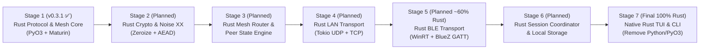

# BitChat Architecture & Rust Migration Roadmap

This document defines the multi-stage engineering roadmap for **BitChat**, tracking its progression from a pure-Python application (`v0.1.0`–`v0.2.1`) through the current hybrid Python + Rust architecture (`v0.3.2`) toward a fully native Rust application.

> **Engineering Policy:** This roadmap describes architectural stages and technical milestones without promising calendar release dates. Stages 1 and 2 (including Rust Cryptography, Noise XX, and the deterministic 12-phase Handshake State Machine) along with native foundations for Stages 3–5 (Mesh Router, LAN Discovery/Framing, BLE Connection Engine) are implemented in `rust/bitchat-core` (`bitchat._bitchat_core`) for `v0.3.2`. The next upcoming milestone is **Phase 2.2 (`v0.3.3`)**, focusing on cross-implementation interoperability and legacy identity compatibility. Stages 6 and 7 remain planned future engineering phases.

---

## 1. Strategic Architectural Direction

| Milestone Phase | Architectural Ownership | Status | Target Release |
| :--- | :--- | :--- | :--- |
| **Legacy Baseline (`v0.1.0`–`v0.2.1`)** | 100% Python (`asyncio` + `Textual` + pure-Python protocol/mesh) | Superseded | `v0.1.0`–`v0.2.1` |
| **Stage 1 Baseline (`v0.3.1`)** | **Hybrid Python Application + Rust Native Core (`bitchat._bitchat_core`, ~25% Rust hot-path ownership)** | ✅ **Completed** | `v0.3.1` |
| **Phase 2 Milestone (`v0.3.2`)** | **Native Rust Cryptography, Noise XX Engine & Transport Foundations (~50% Rust ownership)** (X25519, Ed25519, AEAD, HKDF, PBKDF2, Zeroize, 12-phase FSM, LAN scoring, BLE buffering) | ✅ **Completed** | `v0.3.2` |
| **Phase 2.2 Milestone (`v0.3.3`)** | **Cross-Implementation Interoperability & Security Hardening** (Reference TUI interoperability, legacy peer-ID compatibility, controller buffer limits, deep network diagnostics) | 📋 **Next Milestone** | `v0.3.3` |
| **Stages 3–5 Full Migration** | **~60% Rust Architectural Ownership** (Full native Tokio LAN transport, native BlueZ/WinRT BLE drivers, native mesh routing) | 📋 Planned | `v0.4.0` |
| **Final Objective (Stages 6–7)** | **100% Native Rust Application** (Rust TUI, CLI, Transports, Storage, Crypto, and Protocol; Python, PyO3, and Maturin removed) | 📋 Planned | `v1.0.0` |

---

## 2. Historical Note: Why Rust Replaced the Early Nim Prototype

During early `v0.2.x` exploration, a minimal C-ABI prototype was tested in `nim/` (`nim/protocol/packet_codec.nim`) to evaluate FFI overhead for binary header parsing. Because marshaling trivial structs across `ctypes` offered limited end-to-end gain by itself, profiling under sustained multi-peer mesh workloads demonstrated that moving **stateful, allocation-heavy subsystems** (packet encode/decode, MTU fragmentation, bounded fragment reassembly, SHA-256 deduplication ring caches, and peer rate limiting) into a zero-copy **Rust + PyO3 (`abi3-py312`) + Maturin** crate (`rust/bitchat-core`) eliminated Python object churn and reduced hot-path latency by **6x to 52x**.

The legacy `nim/` directory is retained strictly as an archived historical reference and is not compiled, packaged, or loaded at runtime.

---

## 3. The 7-Stage Python-to-Rust Migration Roadmap

### Stage 1 — Rust Protocol & Mesh Hot-Path Core, TUI Responsiveness & Uninstaller (`v0.3.1` — ✅ Completed)

Implemented in `rust/bitchat-core` (`bitchat._bitchat_core`) and integrated via `src/bitchat/_native.py`:

- **Build & Packaging Foundation:** Cargo workspace (`Cargo.toml`, `rust/bitchat-core/Cargo.toml`) compiled via `maturin` (`pyproject.toml`) into `bitchat._bitchat_core` (`abi3-py312`), bundled into Windows `.exe`, Linux `.deb`, `AppImage`, `Flatpak`, and platform wheels.
- **Native Binary Wire Codec:** `encode_packet_raw`, `decode_packet_raw`, `pad_packet_data`, `unpad_packet_data`, `get_optimal_block_size`, `peer_id_to_hex`, and `peer_id_from_hex` enforcing exact big-endian `BitchatPacket` framing (`FIXED_HEADER_SIZE = 14`, `MINIMUM_PACKET_SIZE = 22`) and PKCS#7-style block padding (`256`/`512`/`1024`/`2048` bytes).
- **Native Fragmentation, Stream Framing & Bounded Reassembly:** `should_fragment_bytes`, `split_chunks`, `create_fragment_payload`, `parse_fragment_payload`, `fragment_encoded_packet_raw`, `NativeFragmentReassembler` (`MAX_FRAGMENTS_PER_ASSEMBLY = 1000`, `MAX_ACTIVE_ASSEMBLIES = 100`, `MAX_REASSEMBLED_BYTES = 150_000`), and `encode_frame_bytes` / `NativeStreamFramer` (`BC\x01\x00` + 4-byte length prefix).
- **Native Mesh Deduplication & Rate Limiting:** `compute_packet_id_raw`, `NativePacketDeduplicator` (SHA-256 `[:16]` digest LRU/TTL cache), and `NativePeerRateLimiter` (bounded sliding-window peer rate limiter).
- **Differential Equivalence & Fallback:** Automatic fallback to pure-Python implementations if `_bitchat_core` is unavailable, verified by differential unit and Hypothesis property tests (`tests/unit/test_native_core.py`).
- **Event-Loop & Textual TUI Optimization:** O(1) incremental message trimming, 16 ms frame-coalesced chat batching, cached autocomplete filtering, non-blocking background thread offloading for storage/subprocess calls, and zero-jitter typing.
- **Cross-Platform Uninstaller:** `bitchat --uninstall` (`--dry-run`, `--remove-user-data`, `--yes`) cleaning standalone binaries, multi-Python console scripts (`Python3XX\Scripts\bitchat.exe`), shortcuts, registry entries, and BitChat-owned `PATH` entries.

---

### Stage 2 — Rust Cryptography & Noise XX Session Engine (✅ Implemented in `rust/bitchat-core`)

- Implemented `X25519`, `Ed25519`, `ChaCha20-Poly1305`, `AES-256-GCM`, `HKDF-SHA256`, and `PBKDF2-HMAC-SHA256` in `rust/bitchat-core/src/crypto.rs` and `noise.rs` using audited Rust crates (`x25519-dalek`, `ed25519-dalek`, `chacha20poly1305`, `aes-gcm`, `hkdf`, `hmac`, `pbkdf2`, `sha2`, `zeroize`).
- Implemented the full `Noise_XX_25519_ChaChaPoly_SHA256` handshake (`NativeNoiseHandshakeState`, `NativeNoiseSymmetricState`), transport `NativeNoiseCipherState` (with 1,024-entry sliding replay window and wire nonce 0 replay protection), `NativeNoiseSession`, and the 12-phase deterministic `NativeHandshakeStateMachine`.
- Enforced deterministic memory scrubbing (`zeroize::Zeroize`) on drop for static private keys, ephemeral handshake keys, chaining keys, and symmetric session keys.
- Verified 100% wire compatibility and byte-for-byte differential test parity against `src/bitchat/crypto/` (`tests/unit/test_native_core.py`).

---

### Stage 3 — Rust Mesh Routing Table & Multi-Hop Scheduler (✅ Implemented in `rust/bitchat-core`)

- Implemented `NativeMeshRouter`, `NativeStoreAndForwardQueue`, and `NativeAckTracker` in `rust/bitchat-core/src/mesh.rs`, integrated with `src/bitchat/mesh/router.py` and `src/bitchat/mesh/store_forward.py`.
- Unified loop prevention, per-peer rate limiting, TTL validation, SHA-256 deduplication, route learning, destination evaluation, and TTL clamping/decrementing inside a single native Rust pass (`evaluate_incoming_raw`).

---

### Stage 4 — Native Rust LAN Transport & Discovery Engine (✅ Implemented in `rust/bitchat-core`)

- Implemented `encode_discovery_packet_raw`, `decode_discovery_packet_raw`, `select_best_lan_ip` (scoring physical Wi-Fi/Ethernet interfaces above virtual WSL/Docker/VPN interfaces), `compute_subnet_broadcast`, `compute_broadcast_targets`, `arbitrate_simultaneous_connection`, `NativeIpRateLimiter`, and asynchronous `tokio` TCP/UDP frame exchange helpers in `rust/bitchat-core/src/lan.rs`.
- Resolved cross-OS LAN handshake progression failures: unconnected discovered peer auto-connect on DM, inbound ephemeral TCP port mapping when `TTL < 7` or UDP discovery is asymmetric, multi-subnet directed UDP broadcast, and stale handshake recovery.

---

### Stage 5 — Native Rust BLE Transport State & Advertisement Engine (~60% Rust Milestone — ✅ Implemented in `rust/bitchat-core`)

- Implemented `encode_ble_manufacturer_payload`, `decode_ble_manufacturer_payload` (supporting backward-compatible 8-byte `peer_id` advertisement extension), `compute_ble_write_chunk_size`, and `NativeBleConnectionEngine` (with pre-ready notification buffering during `SUBSCRIBING`) in `rust/bitchat-core/src/ble.rs`.
- Fixed BLE discovery-to-handshake progression bugs across Windows WinRT and Linux BlueZ: preserved `BluetoothTransport._server_clients` registration on inbound GATT server writes, included active GATT server clients in `BluetoothTransport.connected_peers`, prevented duplicate `BluetoothTransport` callback hijacking in `SessionCoordinator`, and buffered early notifications during `SUBSCRIBING`.

---

### Stage 6 — Rust Session Coordinator, Local Storage & Uninstaller (📋 Planned)

- Migrate `SessionCoordinator` (`src/bitchat/app/session_coordinator.py`), `FileConfigStorage` (`config.json`, `identity.json`, cross-process file locking, Windows DACL / POSIX `0600` enforcement), rotating redacted logging, and the cross-platform uninstaller into Rust crates.
- Introduce optional passphrase-protected key encryption at rest for `identity.json`.

---

### Stage 7 — Native Rust Terminal UI & Removal of Python/PyO3/Maturin (📋 Planned — Final Objective)

- Replace the Python Textual TUI (`src/bitchat/tui/`) and CLI (`src/bitchat/__main__.py`) with a native Rust terminal UI (`ratatui` + `crossterm`) preserving the `HomeScreen`, Peer Grid, Chat Screen, Settings Screen, Connection Modal, and slash commands.
- Remove `pyproject.toml`, `uv.lock`, `PyO3`, `Maturin`, and `PyInstaller`, shipping BitChat as a single, small, zero-dependency native Rust binary across Windows, Linux, and macOS.
