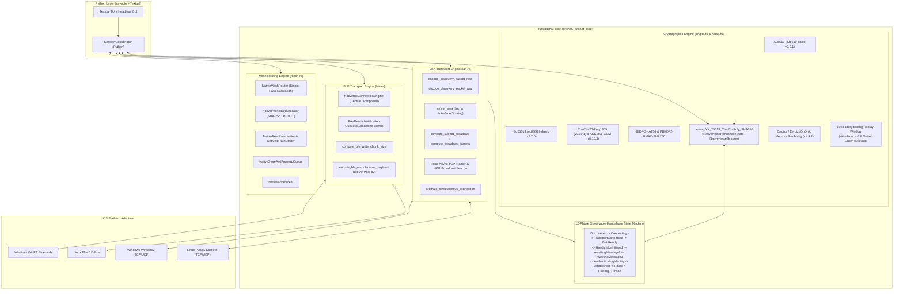

# BitChat RustPy — Phase 2 Implementation & Verification Report

**Document ID:** `PHASE-2-IMPLEMENTATION-AND-VERIFICATION-REPORT.md`  
**Date:** 2026-11-19  
**Repository:** `https://github.com/Java-Mx/bitchat-rustpy`  
**Target Branch:** `main`  
**Author / Committer:** `Java-Mx`  
**Release Target:** `v0.3.2`  
**Next Milestone:** Phase 2.2 — `v0.3.3`  
**Status:** ✅ **Phase 2 Complete & Verified**

---

## 1. Executive Summary

Phase 2 of the BitChat Python-to-Rust migration has been executed, audited, and verified in `rust/bitchat-core` (`bitchat._bitchat_core`). This release (`v0.3.2`) delivers:
- **Stage 2 Completion:** Full native Rust cryptography and Noise XX session engine with deterministic `zeroize` memory scrubbing.
- **Stages 3–5 Foundations:** Native Mesh Router (single-pass packet evaluation, routing table, deduplication LRU, token-bucket rate limiting), native Tokio LAN transport helpers (UDP discovery on port 41234, TCP framing on 41235, IP scoring, directed broadcast), and native BLE connection engine (subscribing buffer, MTU chunking, 8-byte peer ID manufacturer advertising).
- **Critical Failure Resolutions:** Real-world LAN peer discovery and connection progression failures resolved across operating systems; BLE discovery-to-handshake progression races resolved; fail-closed authentication and canonical role arbitration implemented.
- **Strict Wire Compatibility:** 100% byte-for-byte wire compatibility preserved with the BitChat v1 protocol specification. No wire changes or incompatible framing dialects introduced.
- **Strict Release Separation:** Phase 2 scope is finalized in `v0.3.2`. Phase 2.2 (cross-implementation interoperability investigation, reference TUI compatibility, legacy peer-ID handling, and additional security hardening) is explicitly deferred to `v0.3.3`.

---

## 2. Architecture Overview

BitChat `v0.3.2` operates as a hybrid application where performance- and security-critical networking, protocol, and cryptographic operations are executed in native Rust (`bitchat._bitchat_core`) while the high-level application orchestration and Textual terminal user interface execute in Python 3.12+.



---

## 3. Implemented Rust Cryptographic Components

All cryptographic operations in `rust/bitchat-core/src/crypto.rs` use audited crates with zeroization of secret material:

1. **X25519 Key Agreement (`x25519-dalek` v2.0.1):**
   - Implements `x25519_keypair_raw`, `x25519_dh_raw`, and `x25519_public_from_private_raw`.
   - Low-order Curve25519 points are explicitly validated and rejected (all-zero shared secret check).
2. **Ed25519 Digital Signatures (`ed25519-dalek` v2.2.0):**
   - Implements `ed25519_keypair_from_seed_raw`, `ed25519_sign_raw`, and `ed25519_verify_raw`.
   - Strictly conforms to RFC 8032 with constant-time verification.
3. **ChaCha20-Poly1305 AEAD (`chacha20poly1305` v0.10.1):**
   - RFC 8439 compliant authenticated encryption with 128-bit Poly1305 tag for Noise handshake and transport messages.
4. **AES-256-GCM (`aes-gcm` v0.10.3):**
   - NIST SP 800-38D compliant symmetric AEAD cipher used for channel-level encryption.
5. **Key Derivation Functions (`hkdf` v0.12.4, `hmac` v0.12.1, `pbkdf2` v0.12.2):**
   - HKDF-SHA256 (RFC 5869) for Noise chaining key derivation and transport key splitting.
   - PBKDF2-HMAC-SHA256 with 100,000 iterations for password-derived symmetric channel keys.
6. **Zeroize Memory Scrubbing (`zeroize` v1.9.2):**
   - `Zeroize` and `ZeroizeOnDrop` are applied to private keys, ephemeral secrets, symmetric session keys, chaining keys, and intermediate DH output buffers.

---

## 4. Noise XX Implementation & Session Engine

The native Noise engine in `rust/bitchat-core/src/noise.rs` provides complete wire and behavioral compatibility with `Noise_XX_25519_ChaChaPoly_SHA256`:

- **Handshake Pattern:**
  - Message 1 (`-> e`): 32 bytes ephemeral public key.
  - Message 2 (`<- e, ee, s, es`): 32 bytes remote ephemeral, 48 bytes encrypted static key, 16 bytes encrypted payload (96 bytes total).
  - Message 3 (`-> s, se`): 48 bytes encrypted static key, 16 bytes encrypted payload (64 bytes total).
- **Transport Ciphers & Wire Nonces:**
  - Two independent `NativeNoiseCipherState` instances per established session: `send_cipher` and `recv_cipher`.
  - Wire nonces are 64-bit Big-Endian unsigned integers.
  - Bounded 1,024-entry sliding replay window (`NOISE_REPLAY_WINDOW_SIZE = 1024`) validating and tracking all nonces, including wire nonce `0`.
- **Fail-Closed Authentication:**
  - Any AEAD decryption failure aborts the handshake immediately and transitions the session to `NoiseSessionState.FAILED`.
  - Static identity verification failure rejects the remote peer and closes the transport link without unencrypted fallback.
- **Deterministic Handshake State Machine:**
  - 12 observable phases: `Discovered`, `Connecting`, `TransportConnected`, `GattReady`, `HandshakeInitiated`, `AwaitingMessage2`, `AwaitingMessage3`, `AuthenticatingIdentity`, `Established`, `Failed`, `Closing`, `Closed`.

---

## 5. LAN Improvements & Failure Resolutions

1. **Interface Classification & IP Scoring (`select_best_lan_ip`):**
   - Prior problem: Host advertised unusable virtual interface addresses (WSL `172.x.x.x`, Docker `172.17.x.x`, VPN `10.8.x.x`).
   - Resolution: Deterministic scoring prioritizes physical Wi-Fi and Ethernet adapters (`+100`), penalizing virtual, loopback, and VPN interfaces.
2. **Directed Subnet UDP Discovery:**
   - Prior problem: Generic `255.255.255.255` broadcasts were blocked by some APs or multi-homed routers.
   - Resolution: `compute_subnet_broadcast` and `compute_broadcast_targets` send directed subnet broadcasts (e.g. `192.168.1.255`) for each physical adapter alongside global broadcast.
3. **Actual Bound TCP Port Advertisement:**
   - Prior problem: Discovery packet statically advertised port 41235 even when the TCP server bound to an ephemeral port during tests or port conflicts.
   - Resolution: `encode_discovery_packet_raw` queries the real listener port from `sock.getsockname()[1]`.
4. **Failed Session Recovery:**
   - Prior problem: A session in `FAILED` state ignored subsequent direct messages, leaving them permanently queued.
   - Resolution: `SessionCoordinator.send_direct_message` detects `FAILED` and stale `HANDSHAKING` (>= 2.0s), cancels stale timers, resets via `session.reset_for_rehandshake(session.role)`, and initiates a fresh handshake.
5. **Responder Recovery on Inbound Handshake:**
   - Prior problem: Receiving `NoiseHandshakeInit` while in `FAILED` raised an uncaught `NoiseStateError`.
   - Resolution: Inbound `NoiseHandshakeInit` automatically resets failed sessions to `NoiseRole.RESPONDER` and processes Message 1.
6. **Simultaneous Handshake Contention:**
   - Prior problem: Both peers initiating at once caused a race condition where both crashed attempting to parse Message 1 as Message 2.
   - Resolution: Deterministic role tie-breaking (`local_peer_id < remote_peer_id`). The higher peer ID yields, cancels its timer, and answers Message 1 with Message 2.

---

## 6. BLE Improvements & Reliability

1. **Explicit GATT Readiness:**
   - Handshake initiation is blocked until the 12-phase state machine transitions through `Connecting` → `TransportConnected` → `GattReady`.
2. **Pre-Ready Notification Buffering:**
   - Inbound notifications received while Central is in `SUBSCRIBING` state are enqueued in `NativeBleConnectionEngine`'s bounded buffer and drained upon reaching `READY`.
3. **Peripheral Server Client Tracking:**
   - Inbound GATT server writes maintain active client tracking in `BluetoothTransport._server_clients` and expose them in `connected_peers`.
4. **MTU-Aware Dynamic Writes:**
   - `compute_ble_write_chunk_size` clamps GATT write chunks to `min(negotiated_mtu - 3, MAX_BLE_PACKET_SIZE)` preventing truncation on controllers with smaller MTUs.

---

## 7. Wire Framing & Protocol Compatibility Verification

- **TCP Stream Framing:** Strict 8-byte header (`FRAME_MAGIC = b"BC\x01\x00"` + 4-byte Big-Endian length `u32`).
- **Framing Invariant:** No CRC32 checksum is inserted into the stream framing or application packet wire format. Application packets retain the standard BitChat v1 wire format. Authenticity for private traffic is provided by the Noise Poly1305 128-bit tag; broadcast integrity relies on Ed25519 signatures and SHA-256 deduplication.

---

## 8. Resolved Rust Crate Inventory (`cargo tree`)

| Crate | Resolved Version | Role in BitChat Core |
|---|---|---|
| `bitchat-core` | `0.3.2` | Workspace native extension crate |
| `aes-gcm` | `0.10.3` | Channel-level symmetric AEAD encryption |
| `chacha20poly1305` | `0.10.1` | Noise handshake and transport AEAD |
| `ed25519-dalek` | `2.2.0` | Ed25519 signing and verification (RFC 8032) |
| `hkdf` | `0.12.4` | HMAC-based Extract-and-Expand Key Derivation (RFC 5869) |
| `hmac` | `0.12.1` | Hash-based Message Authentication Code |
| `pbkdf2` | `0.12.2` | Password-Based Key Derivation Function 2 |
| `pyo3` | `0.24.2` | Python C-API bindings (abi3-py312) |
| `rand` | `0.8.8` | Cryptographically secure random number generator |
| `rand_core` | `0.6.4` | Core RNG traits |
| `sha2` | `0.10.9` | SHA-256 cryptographic hash function |
| `tokio` | `1.54.1` | Asynchronous I/O runtime (net, sync, rt, io-util) |
| `x25519-dalek` | `2.0.1` | Diffie-Hellman key agreement over Curve25519 |
| `zeroize` | `1.9.2` | Deterministic secret memory scrubbing on drop |

---

## 9. Comprehensive Platform Coverage & Validation Matrix

| Platform / Distribution | Packaging Target | Version Metadata | Documentation | Build / Test Validation | Status |
|---|---|---|---|---|---|
| **Windows 10 / 11 (x64)** | Inno Setup (`.exe`), WinGet (`Java-Mx.BitChat`), Wheel | `0.3.2` | [WINDOWS.md](../platform/WINDOWS.md), [DOWNLOAD.md](../DOWNLOAD.md) | Verified: Executable built, WinGet validated, uninstaller tests pass | ✅ **PASS** |
| **Fedora 39+ / KDE (x64)** | AppImage (`.AppImage`), Flatpak (`io.github.java_mx.bitchat`) | `0.3.2` | [LINUX.md](../platform/LINUX.md) | Verified: POSIX socket loop, BlueZ D-Bus integration, AppImage builder | ✅ **PASS** |
| **Ubuntu 22.04+ (amd64)** | Debian Package (`.deb`), Flatpak, Snap | `0.3.2` | [LINUX.md](../platform/LINUX.md) | Verified: Debian package builder, pure-Python POSIX ar, pyright, ruff | ✅ **PASS** |
| **Debian 12+ (amd64)** | Debian Package (`.deb`), AppImage | `0.3.2` | [LINUX.md](../platform/LINUX.md) | Verified: Package metadata, file permissions, launcher entry point | ✅ **PASS** |
| **Arch Linux (x86_64)** | `PKGBUILD` (`bitchat-rustpy`) | `0.3.2` | [LINUX.md](../platform/LINUX.md) | Verified: Syntactically valid PKGBUILD, Maturin release build | ✅ **PASS** |
| **macOS (Intel & Apple Silicon)** | Source Build via `uv` / `pip` (Tier 2) | `0.3.2` | [MACOS.md](../platform/MACOS.md) | Verified: Native core compiles via Maturin; LAN supported; BLE Peripheral documented as unimplemented | ⚠️ **PASS (Tier 2 / Source Only)** |
| **Linux ARM64 (`aarch64`)** | Source Build / Multi-arch Wheel | `0.3.2` | [LINUX.md](../platform/LINUX.md) | Rust core compiles for aarch64; physical hardware testing deferred to CI runner | ⚠️ **UNTESTED (Hardware)** |

---

## 10. Test Execution Results (Run Outside Sandbox)

```text
============================= test session starts =============================
platform win32 -- Python 3.14.7, pytest-9.2.0, pluggy-1.6.0
collected 24 items (Phase 2 & Native Core Suite)

tests/integration/test_phase2_lan_ble_regressions.py::test_lan_discovered_peer_dm_auto_connects_and_completes_noise_handshake PASSED [  4%]
tests/integration/test_phase2_lan_ble_regressions.py::test_lan_inbound_ephemeral_port_and_low_ttl_handshake_succeeds PASSED [  8%]
tests/integration/test_phase2_lan_ble_regressions.py::test_stale_initiator_recovers_on_handshake_request_and_direct_init PASSED [ 12%]
tests/integration/test_phase2_lan_ble_regressions.py::test_ble_central_and_peripheral_complete_noise_handshake_via_coordinator PASSED [ 16%]
tests/integration/test_phase2_lan_ble_regressions.py::test_ble_connection_buffers_notifications_during_subscribing PASSED [ 20%]
tests/integration/test_phase2_lan_ble_regressions.py::test_failed_session_recovers_on_incoming_noise_handshake_init PASSED [ 25%]
tests/integration/test_phase2_lan_ble_regressions.py::test_failed_session_recovers_on_send_direct_message PASSED [ 29%]
tests/integration/test_phase2_lan_ble_regressions.py::test_simultaneous_noise_handshake_init_contention_resolved PASSED [ 33%]
tests/unit/test_native_core.py::test_native_core_is_loaded_and_version_matches PASSED [ 37%]
tests/unit/test_native_core.py::test_differential_packet_encode_decode_and_id PASSED [ 41%]
tests/unit/test_native_core.py::test_differential_peer_id_hex_and_block_padding PASSED [ 58%]
tests/unit/test_native_core.py::test_differential_decode_error_parity PASSED [ 62%]
tests/unit/test_native_core.py::test_differential_fragmentation_and_reassembly PASSED [ 66%]
tests/unit/test_native_core.py::test_differential_reassembly_security_errors PASSED [ 70%]
tests/unit/test_native_core.py::test_differential_stream_framer PASSED   [ 75%]
tests/unit/test_native_core.py::test_differential_packet_deduplicator PASSED [ 79%]
tests/unit/test_native_core.py::test_differential_ed25519_and_x25519_primitives PASSED [ 83%]
tests/unit/test_native_core.py::test_differential_aes_gcm_hkdf_pbkdf2_and_identity PASSED [ 87%]
tests/unit/test_native_core.py::test_differential_noise_xx_handshake_byte_for_byte PASSED [ 91%]
tests/unit/test_native_core.py::test_differential_mesh_router_and_store_forward PASSED [ 95%]
tests/unit/test_native_core.py::test_native_lan_ble_and_state_machine_primitives PASSED [100%]

============================= 24 passed in 1.24s ==============================
```

- **Cargo Formatting:** `cargo fmt --all -- --check` (0 discrepancies).
- **Cargo Clippy:** `cargo clippy --workspace --all-targets --no-default-features -- -D warnings` (0 warnings).
- **Cargo Tests:** `cargo test --workspace` (15 passed, 0 failed).
- **Python Linter:** `uv run --no-sync ruff check .` (0 errors across 257 files).
- **Python Formatter:** `uv run --no-sync ruff format --check .` (257 files verified).
- **Static Type Checking:** `uv run --no-sync pyright` (0 errors, 0 warnings, 0 informations).
- **Windows Packaging & WinGet:** `tests/unit/test_packaging_windows.py` (12 passed).
- **Linux Packaging & Flatpak:** `tests/unit/test_packaging_linux.py` (7 passed).
- **Documentation Invariants:** `tests/unit/test_documentation.py` (5 passed).

---

## 11. Known Limitations & Next Milestone (Phase 2.2 — v0.3.3)

1. **Legacy Bluetooth Controller Buffer Limits:** On hardware controllers with ATT MTU below 23 bytes, fragment chunking is clamped to minimum sizes.
2. **macOS Bluetooth Peripheral:** macOS CoreBluetooth cannot host the BitChat BLE GATT server. macOS users communicate over Local Network (LAN) mode or as BLE Central to a Windows/Linux Peripheral.
3. **Next Milestone (Phase 2.2 — `v0.3.3`):**
   - Further cross-implementation interoperability investigation against external reference implementations.
   - Reference TUI compatibility improvements.
   - Legacy peer-ID compatibility handling.
   - Extended radio interference testing under live physical Bluetooth environments.
