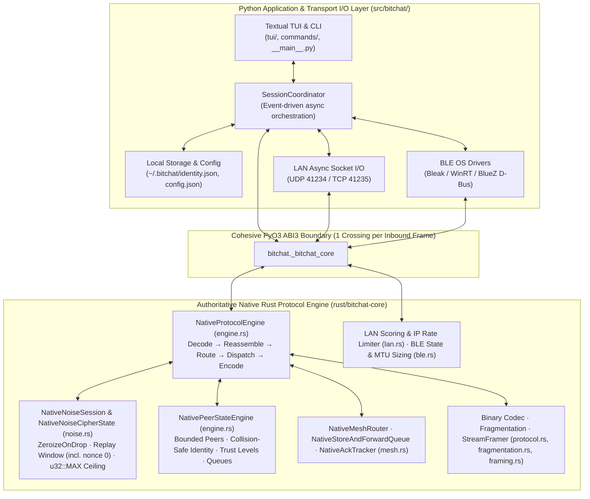

# BitChat RustPy `v0.3.3` — Rust Migration, Performance & Security Impact Report

**Release:** `v0.3.3` (Phase 2.2 — Authoritative Rust Protocol Integration & Stage 3 Mesh/Peer State Engine)  
**Baseline Compared Against:** `v0.3.2` (Phase 2 — Native Rust Cryptography & Transport Foundations)  
**Repository:** [https://github.com/Java-Mx/bitchat-rustpy](https://github.com/Java-Mx/bitchat-rustpy)  
**Related Documents:**
- [`V0.3.3-RELEASE-NOTES.md`](V0.3.3-RELEASE-NOTES.md)
- [`PHASE-2.2-IMPLEMENTATION-AND-VERIFICATION-REPORT.md`](PHASE-2.2-IMPLEMENTATION-AND-VERIFICATION-REPORT.md)
- [`docs/ROADMAP.md`](../ROADMAP.md)
- [`scripts/benchmark_phase22.py`](../../scripts/benchmark_phase22.py)

---

## 1. Executive Summary

BitChat `v0.3.3` represents the architectural inflection point where the native Rust crate (`rust/bitchat-core`, compiled via PyO3 + Maturin as `bitchat._bitchat_core`) transitions from an optional library of cryptographic/codec helpers into the **single authoritative runtime owner** of BitChat's protocol-critical communication pipeline.

In `v0.3.2`, Rust primitives for cryptography, Noise XX, mesh routing, store-and-forward, LAN rate limiting, and BLE MTU sizing already existed in `rust/bitchat-core`, but live execution still suffered from three structural problems:
1. Several native engines (`NativeNoiseSession`, `NativeAckTracker`, `NativeIpRateLimiter`, `compute_ble_write_chunk_size`) were implemented in Rust but **not wired into live Python execution**.
2. `MeshRouter` and `StoreAndForwardQueue` executed **both** Python and Rust on every call, duplicating CPU work and maintaining competing copies of mutable state.
3. Inbound packet processing crossed the PyO3 FFI boundary **4+ times per encrypted message**, creating avoidable Python heap objects and marshaling overhead.

In `v0.3.3`:
- Rust owns live Noise XX session state (`NativeNoiseSession`), single-FFI inbound protocol processing (`NativeProtocolEngine`), bounded collision-safe peer/identity state (`NativePeerStateEngine`), single-pass mesh routing (`NativeMeshRouter`), store-and-forward (`NativeStoreAndForwardQueue`), ACK tracking (`NativeAckTracker`), LAN IP rate limiting (`NativeIpRateLimiter`), and BLE ATT MTU chunk sizing.
- Inbound encrypted DM processing drops from **4+ PyO3 crossings to 1**, improving full-pipeline throughput by **7.28x–8.04x** and lowering Python `tracemalloc` peak heap allocation over 1,000 frames from **105.7 KiB to 0.8 KiB (~132x lower Python heap pressure in the measured workload)**.
- Cryptographic and DoS invariants are tightened across the board: zero eager Python key copies, fail-closed `u32::MAX` nonce exhaustion guard, strict nonce-0 replay rejection, collision-safe controlled legacy `bitchat-tui` interoperability, and bounded pending DM queues (`32` per peer / `512` global).

---

## 2. `v0.3.2` Architecture Baseline

In `v0.3.2`:
- Python `NoiseSession` orchestrated `NoiseHandshakeState` and `NoiseCipherState` wrappers, while `NoiseCipherState` eagerly copied the 32-byte key into an unzeroized Python `bytes` object (`self._key`). `NativeNoiseSession` existed in `rust/bitchat-core/src/noise.rs` but was not called at runtime.
- `MeshRouter` and `StoreAndForwardQueue` maintained parallel Python structures alongside Rust instances, executing both paths on every packet.
- Inbound `NoiseEncrypted` frames crossed Python → Rust → Python repeatedly: (1) unpad/decode, (2) dedup/route, (3) decrypt, (4) update Python peer/session dictionaries.
- `SessionCoordinator` used an unbounded `_pending_messages` dict, an `asyncio.sleep(0.04)` polling loop for out-of-order `NoiseEncrypted` frames, and mixed `time.perf_counter()` with `time.monotonic()`.
- `LANDiscovery` ran a Python IP rate-limit dictionary instead of `NativeIpRateLimiter`, and `BluetoothTransport` ignored controller-negotiated `client.mtu_size`.

---

## 3. `v0.3.3` Architecture After Migration



---

## 4. Python vs. Rust Responsibility Map

| Component | `v0.3.2` Ownership | `v0.3.3` Ownership | Future Target |
|---|---|---|---|
| **Cryptography Primitives** (`X25519`, `Ed25519`, `ChaCha20-Poly1305`, `AES-256-GCM`, `HKDF`, `PBKDF2`) | Rust foundation | **Rust (Authoritative)** | Rust |
| **Noise XX Sessions** (`Noise_XX_25519_ChaChaPoly_SHA256`) | Python orchestration + Rust primitives | **Authoritative Rust (`NativeNoiseSession`)** | Rust |
| **Packet Processing** (Codec, Padding, Fragmentation, Reassembly, Dispatch) | Native helpers + piecewise Python orchestration | **Native Protocol Engine (`NativeProtocolEngine`, 1 FFI crossing)** | Rust |
| **Mesh Routing, Dedup & Store-and-Forward** | Mixed / duplicate Python + Rust execution | **Authoritative Rust (`NativeMeshRouter`, `NativeStoreAndForwardQueue`, `NativeAckTracker`)** | Rust |
| **Peer State & Identity/Trust Management** | Python dictionaries & mixed state | **Authoritative Rust (`NativePeerStateEngine`)** | Rust |
| **LAN Engine** (Framing, Interface Scoring, IP Rate Limiter vs. Sockets) | Native foundations / Python I/O + Python rate limiter | **Hybrid** (Rust framing, scoring, IP rate limiter + Python `asyncio` UDP/TCP I/O) | Full Rust (Stage 4) |
| **BLE Engine** (State Machine, Buffering, MTU Sizing vs. OS Drivers) | Native foundations / Python OS drivers (fixed 150 B chunks) | **Hybrid** (Rust connection state, notification buffering, ATT MTU chunking + Python Bleak/WinRT/BlueZ drivers) | Full Rust (Stage 5) |
| **Session Coordinator** | Python | **Hybrid** (Rust peer/ACK/Noise/protocol engines + Python async lifecycle) | Full Rust (Stage 6) |
| **Local Storage (`~/.bitchat/`)** | Python | **Python** | Rust (Stage 6) |
| **TUI & CLI** | Python | **Python** (Textual TUI + CLI) | Rust (Stage 7) |

---

## 5. Performance Impact Comparison

Measured using [`scripts/benchmark_phase22.py`](../../scripts/benchmark_phase22.py) on **Windows 11 AMD64, Python 3.14.7, Rust stable toolchain, release-optimized `bitchat._bitchat_core v0.3.3`**, running identical workloads against the pure-Python reference implementations (`Py*`/`py_*`) and native Rust implementations:

| Operation | Pure Python | Native Rust (`v0.3.3`) | Measured Speedup (Baseline Run) | Confirmation Re-Run |
|---|---:|---:|---:|---:|
| Packet encoding (padded 256 B) | `2.12 µs` | `1.18 µs` | **1.80x faster** | `2.83x` (`2.54` vs `0.90 µs`) |
| Packet decoding (padded 256 B) | `7.15 µs` | `4.00 µs` | **1.79x faster** | `2.07x` (`4.85` vs `2.35 µs`) |
| Noise XX full 3-msg handshake | `680.36 µs` | `669.89 µs` | **1.02x** *(~parity)* | `1.03x` (`614.96` vs `594.29 µs`) |
| Noise transport encrypt + decrypt (220 B) | `87.55 µs` | `7.38 µs` | **11.86x faster** | `9.19x` (`72.70` vs `7.91 µs`) |
| Fragmentation & reassembly (2 KB) | `104.48 µs` | `38.18 µs` | **2.74x faster** | `2.88x` (`105.75` vs `36.68 µs`) |
| Packet deduplication (SHA-256 LRU) | `4.46 µs` | `1.06 µs` | **4.19x faster** | `2.93x` (`2.50` vs `0.86 µs`) |
| Mesh routing (1-pass Rust vs Python) | `7.45 µs` | `4.33 µs` | **1.72x faster** | `1.70x` (`7.84` vs `4.61 µs`) |
| LAN TCP stream framing (20 frames) | `30.17 µs` | `1.19 µs` | **25.34x faster** | `11.62x` (`17.80` vs `1.53 µs`) |
| Full inbound DM pipeline (1,000 packets) | `176.25 µs` | `24.20 µs` | **7.28x faster** | `8.04x` (`208.66` vs `25.96 µs`) |

### Honest Interpretation of Benchmark Results
- **Why Noise XX full handshake is ~1.02x–1.03x:** Both Python's `cryptography` (OpenSSL/Rust backend) and Rust's `x25519-dalek` spend the vast majority of the ~600–680 µs 3-message handshake in compiled Curve25519 scalar multiplication. The gain of moving Noise XX to Rust is **memory safety, zeroization, single authoritative state, and transport AEAD speed (9.19x–11.86x faster)** — not dramatically faster Curve25519 math.
- **Why transport AEAD + inbound pipeline see large speedups (7.28x–11.86x):** Eliminating per-packet Python wrapper objects, per-step PyO3 marshaling, and duplicate Python+Rust mesh execution removes CPython interpreter and GC overhead from every message frame.
- These measurements are environment-specific benchmarks from `scripts/benchmark_phase22.py` on one Windows 11 AMD64 host, not universal guarantees across all CPUs or operating systems.

---

## 6. Security Impact Comparison

| Security Area | `v0.3.2` Limitation / Risk | `v0.3.3` Improvement | Implementation & Test Evidence |
|---|---|---|---|
| **Active Noise Session Ownership** | Python `NoiseSession` orchestrated handshake & cipher state; `NativeNoiseSession` existed in Rust unused | Authoritative Rust `NativeNoiseSession` owns handshake FSM, send/recv ciphers, and state transitions | `rust/bitchat-core/src/noise.rs`, `src/bitchat/crypto/sessions.py`; `tests/interoperability/test_tui_interop.py::test_differential_noise_session_rust_vs_python_reference` |
| **Secret Key Memory Handling** | `NoiseCipherState` eagerly copied the 32-byte key into unzeroized Python `bytes` (`self._key`) | Removed eager Python key copy; active session keys stay inside `zeroize::ZeroizeOnDrop`-managed Rust structs | `rust/bitchat-core/src/noise.rs`, `src/bitchat/crypto/noise.py` |
| **Transport Nonce Exhaustion** | No upper bound check before `u32::MAX` (4-byte wire nonce wraparound risk) | Enforced `NOISE_MAX_TRANSPORT_NONCE = u32::MAX` fail-closed (`InvalidNonce`) + `needs_rekey()` warning at `1_000_000_000` | `rust/bitchat-core/src/noise.rs`, `src/bitchat/crypto/noise.py`; `cargo test test_nonce_exhaustion_fails_closed_and_failed_aead_does_not_mark_replay`, `test_nonce_exhaustion_fails_closed_without_wraparound` |
| **Replay Protection (Nonce 0)** | Historical risk of exempting wire nonce `0` from replay tracking | Strict 1,024-entry sliding replay window tracking every nonce including `0` unconditionally | `rust/bitchat-core/src/noise.rs`; `test_tui_noise_xx_exact_wire_format_and_nonce_zero_replay_protection` |
| **Failed AEAD Replay Mutation** | Risk of advancing replay window before authentication tag verifies | Replay window advances strictly **after** `ChaCha20Poly1305::decrypt` tag verification succeeds | `rust/bitchat-core/src/noise.rs`; `cargo test test_nonce_exhaustion_fails_closed_and_failed_aead_does_not_mark_replay` |
| **Peer Identity Binding & Collisions** | Mixed Python contact dicts without reverse collision index | Collision-safe `peer_id <-> fingerprint` registry with reverse collision rejection inside `NativePeerStateEngine` | `rust/bitchat-core/src/engine.rs`; `cargo test test_peer_state_collision_and_unauthenticated_overwrite_rejected`, `test_coordinator_interop_with_legacy_tui_peer_reconnect_and_impostor_rejection` |
| **Legacy `bitchat-tui` Peer IDs** | Strict modern SHA-256 check blocked compatible legacy 4-byte zero-extended TUI peers (`XXXXXXXX00000000`) | Controlled legacy compatibility: pinned strictly **after** Noise XX static-key authentication with impostor collision rejection; modern peers still require strict SHA-256 match | `rust/bitchat-core/src/protocol.rs`, `noise.rs`, `engine.rs`; `test_tui_protocol_constants_and_legacy_peer_id_classification`, `cargo test test_native_session_legacy_tui_compat_and_collision_rejection` |
| **Pending DM Queue Exhaustion** | Unbounded `_pending_messages` dict in `SessionCoordinator` (memory DoS vector) | Hard cap of `32` pending messages per peer and `512` globally in both `SessionCoordinator` and `NativePeerStateEngine` | `src/bitchat/app/session_coordinator.py`, `rust/bitchat-core/src/engine.rs`; `test_pending_dm_queue_bounded_and_delivery_ack_tracked` |
| **Peer State Ownership** | Mutable peer metadata & nicknames scattered across Python dicts; unauthenticated announces could risk spoofing | Bounded `NativePeerStateEngine` prevents unauthenticated `Announce` / `NoiseIdentityAnnounce` overwrites of authenticated bindings | `rust/bitchat-core/src/engine.rs`; `test_noise_identity_announce_parsing_and_coordinator_handling` |
| **Protocol Downgrade / Fallback** | Risk of falling back to plaintext or legacy crypto on Noise failure | Fail-closed behavior: handshake, identity, replay, or AEAD failures reject/drop frames and zeroize transient ciphers without downgrading | `rust/bitchat-core/src/noise.rs`, `engine.rs`; `tests/e2e/test_tier2_encryption_boundaries.py` |

### Important Security Nuances & Non-Guarantees
1. **Memory Zeroization Scope:** Rust's `zeroize::ZeroizeOnDrop` deterministically scrubs owned Rust heap/stack secret buffers on drop, reset, or error. However, zeroization **cannot** guarantee removal of every copy from OS swap/pagefiles, kernel crash dumps, hardware caches, or Python-side identity loading (`~/.bitchat/identity.json`) until Stage 6 moves storage natively into Rust.
2. **Identity Trust Semantics (Three Distinct States):**
   - **`observed`:** A peer ID / nickname has been seen in unauthenticated discovery or `Announce` beacons. No cryptographic proof exists.
   - **`authenticated`:** The peer completed a Noise XX handshake proving possession of the X25519 static private key corresponding to its fingerprint. **Possession of a Noise private key proves cryptographic continuity, NOT real-world human identity.**
   - **`verified`:** The user explicitly confirmed the peer's 64-character SHA-256 fingerprint out-of-band (`verify_peer_identity` / `/verify`).

---

## 7. Memory Allocation & FFI Crossing Reduction

| Metric | Previous Architecture (`v0.3.2`) | `v0.3.3` Architecture |
|---|---|---|
| **PyO3 crossings per inbound encrypted frame** | `4+` (decode → dedup/route → decrypt → state update) | **`1`** (`NativeProtocolEngine.process_inbound_frame`) |
| **Python `tracemalloc` peak allocation (1,000 inbound DMs)** | `105.7 KiB` | **`0.8 KiB`** |
| **Measured Python pipeline heap reduction** | Baseline | **~132x lower Python `tracemalloc` peak allocation** *(in the 1,000-frame benchmark workload; not 132x lower total process RAM)* |
| **Mesh runtime ownership** | Parallel Python + Rust execution | **Single authoritative Rust execution path** |
| **Peer-state ownership** | Python dictionaries and mixed state | **Bounded native Rust `NativePeerStateEngine`** |

Reducing FFI crossings from `4+` to `1` eliminates intermediate Python `BitchatPacket` allocations, redundant bytes copying across the boundary, CPython reference-counting churn, and GC pause pressure on bursty mesh traffic.

---

## 8. Mesh Routing & Noise Session Ownership Changes

- **Mesh Routing (`src/bitchat/mesh/router.py`, `store_forward.py`):** When `bitchat._bitchat_core` is loaded, `MeshRouter` and `StoreAndForwardQueue` no longer instantiate or update `PyMeshRouter` / `PyStoreAndForwardQueue` in parallel. Single-pass `NativeMeshRouter.evaluate_incoming_raw` handles loop prevention, rate limiting, TTL checks, deduplication, and forwarding decisions atomically in Rust, exposed to compatibility callers via lightweight views (`_NativeRateLimiterView`, `_NativeRouterDedupAdapter`).
- **Noise Sessions (`src/bitchat/crypto/sessions.py`, `rust/bitchat-core/src/noise.rs`):** `NoiseSession` delegates directly to `NativeNoiseSession`. On inbound `NoiseHandshakeInit` for an already-established peer (reconnect), `reset_for_rehandshake()` drops and zeroizes stale ciphers cleanly in Rust before initiating a new ephemeral exchange. `PyNoiseSession` remains solely for differential equivalence tests and non-native fallback environments.

---

## 9. Peer Identity, Authentication & Interoperability Changes

- Added `classify_peer_id_raw` / `normalize_peer_id_raw` (`rust/bitchat-core/src/protocol.rs`): classifies 8-byte IDs as `modern` vs `legacy_tui` (`XXXXXXXX00000000`).
- Added `parse_noise_identity_announce_raw` (`0x13`) with Ed25519 signature verification and wired `0x0A DeliveryAck` tracking via `NativeAckTracker`.
- Replaced `for _ in range(25): await asyncio.sleep(0.04)` polling in `SessionCoordinator` with per-peer `asyncio.Event` (`_session_established_events`), and unified handshake timeout checks on `time.monotonic()`.

---

## 10. LAN & BLE Integration Changes

- **LAN (`src/bitchat/network/discovery.py`, `rust/bitchat-core/src/lan.rs`):** Wired `NativeIpRateLimiter` (`10` UDP discovery packets/sec per IP) into `LANDiscovery`, complementing existing Rust interface scoring (`select_best_lan_ip`), dynamic TCP port advertisement, and simultaneous connection arbitration. Socket I/O loops remain in Python `asyncio` until Stage 4 completes.
- **BLE (`src/bitchat/ble/connection.py`, `transport.py`, `protocol/fragmentation.py`, `rust/bitchat-core/src/ble.rs`):** Wired controller-reported `client.mtu_size` into `NativeBleConnectionEngine` and `compute_ble_write_chunk_size`, passing negotiated `chunk_size` into `fragment_encoded_packet`. OS GATT drivers (WinRT / BlueZ D-Bus via Bleak) remain in Python until Stage 5 completes.

---

## 11. Cross-Platform Verification & Honest Limitations

| Verification Scope | Environment | Status |
|---|---|---|
| **GitHub Actions CI Matrix** | `ubuntu-latest` & `windows-latest`, Python **3.12 & 3.13** (`cargo fmt`, `clippy -D warnings`, `cargo test`, `ruff`, `pyright`, full `pytest`) | **PASS** |
| **Local Developer Verification** | Windows 11 AMD64, Python **3.14.7** *(not in official CI matrix)*, Rust stable (`21/21` Rust tests, `1,285` Python tests passed / `1` skipped + `6/6` Windows `.pyd` lock tests) | **PASS** |
| **GitHub Actions Release (`44473478669`)** | Windows x64 (`.exe` + silent install/uninstall smoke test + `.whl` + WinGet), Linux `x86_64` (`.deb` + `.AppImage` + `.whl` + `.tar.gz`), macOS Apple Silicon `arm64` (`.whl` + `--version` + native/interop tests) | **PASS** (15 assets published) |
| **WinGet Manifests** | `manifests/j/Java-Mx/BitChat/0.3.3/` & `packaging/windows/winget/Java-Mx.BitChat.yaml` | **VALIDATED LOCALLY** (`winget validate`); upstream `microsoft/winget-pkgs` PR is separate |
| **Simulated BLE & Interop Tests** | WinRT/BlueZ fakes & wire-level `bitchat-tui` specification tests (`tests/interoperability/test_tui_interop.py`) | **PASS** |
| **Physical Two-Machine BLE / LAN Hardware** | Over-the-air WinRT ↔ BlueZ ↔ `bitchat-tui` binary | **UNTESTED** (no dual physical hardware in automated environment) |
| **macOS Limitations** | `.dmg`/`.pkg` installers, Intel `x86_64` prebuilt wheel, and macOS BLE Peripheral GATT server | **NOT IMPLEMENTED** (source build supported on Intel; LAN & Offline supported on macOS) |

---

## 12. Remaining Unfinished Migration & Next Roadmap Milestones

BitChat `v0.3.3` is **not** 100% Rust yet. Remaining Python-owned layers are explicitly tracked in [`docs/ROADMAP.md`](../ROADMAP.md):
- **Stage 4 (Remaining):** Full native Tokio UDP discovery and TCP server/client socket loops replacing Python `asyncio` LAN I/O.
- **Stage 5 (Remaining):** Full native Rust BLE Central & Peripheral OS drivers (WinRT, BlueZ D-Bus, CoreBluetooth) replacing Python `bleak` / `dbus-fast`.
- **Stage 6 (Planned):** Native Rust `SessionCoordinator`, local storage (`identity.json`, `config.json`, optional passphrase encryption at rest), redacted logging, and uninstaller.
- **Stage 7 (Planned):** Native Rust TUI (`ratatui`) and CLI, retiring Python, PyO3, and Maturin completely.

---

## 13. Reproducing the Benchmarks

```powershell
# 1. Build the release native extension safely
uv run --no-sync python scripts/build_native.py

# 2. Run the reproducible Phase 2.2 benchmark suite
uv run --no-sync python scripts/benchmark_phase22.py
```

The script executes identical input payloads against both pure-Python (`Py*` / `py_*`) and native Rust (`_bitchat_core`) code paths in the same process and reports median/mean microsecond latency, speedup ratios, FFI crossing counts, and Python `tracemalloc` peak heap allocations.
